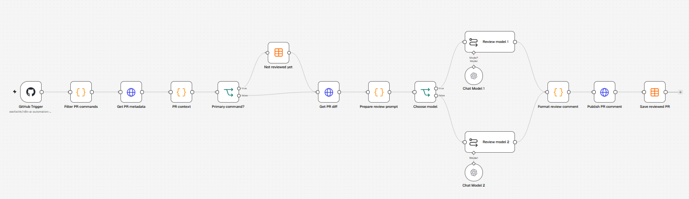
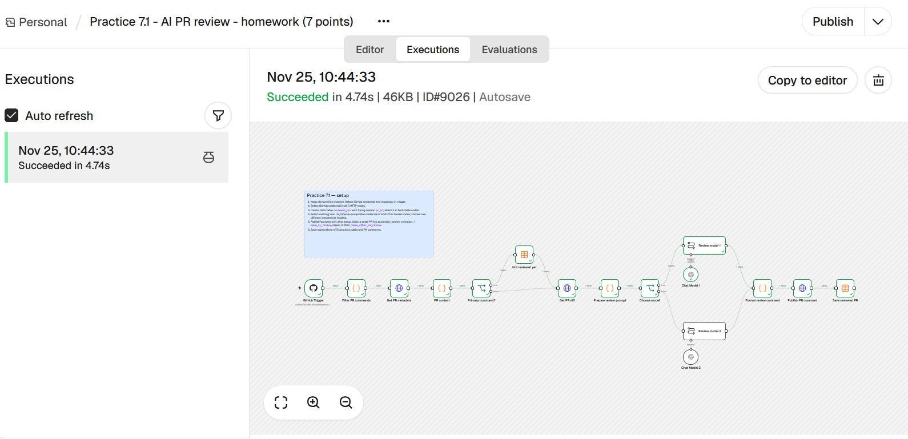
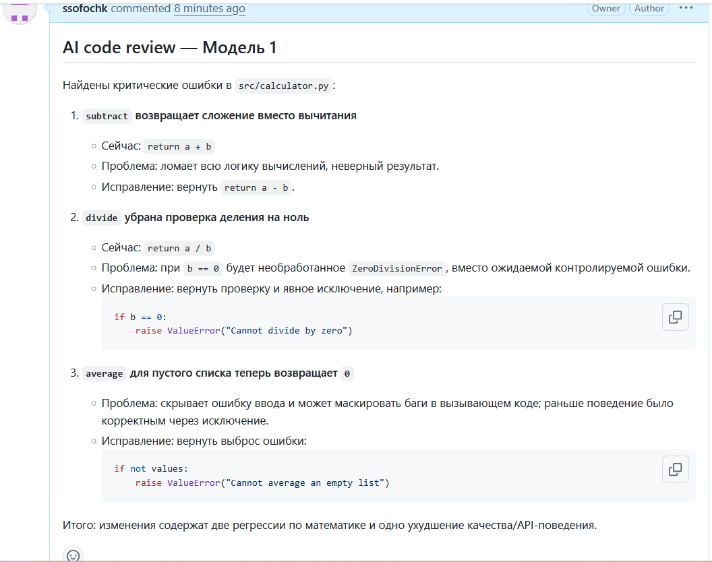
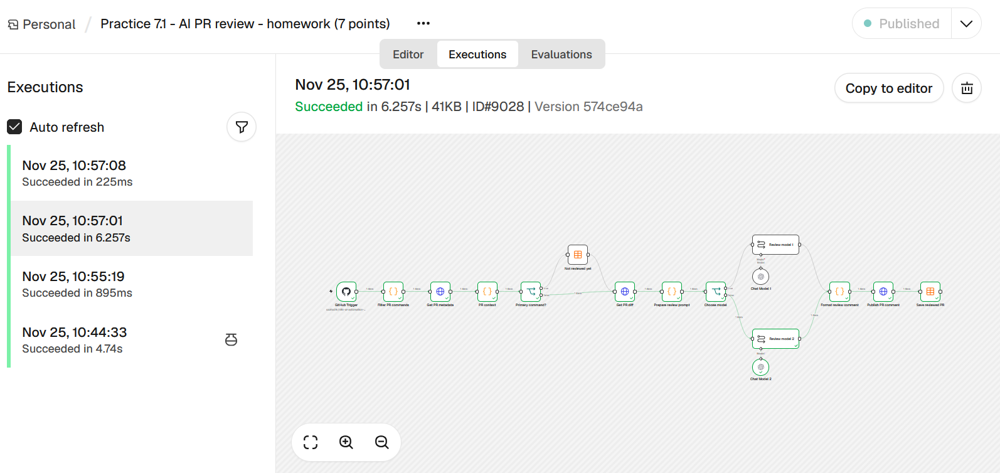
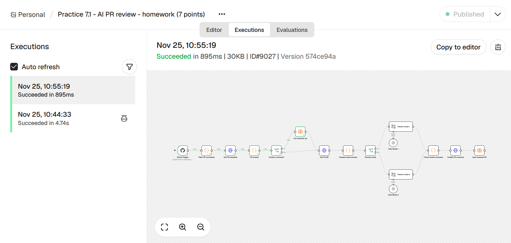
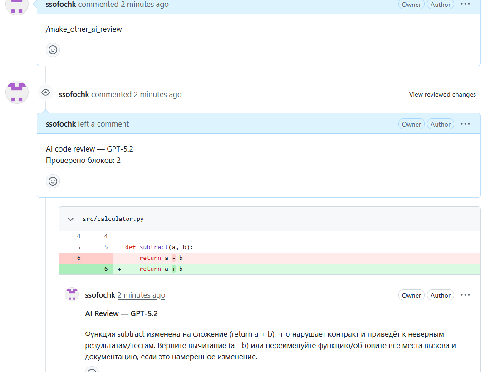

# Отчёт по практической работе 7.1
## Создание AI-ассистента для код-ревью в n8n

### 1. Цель работы

Разработать автоматизированный сценарий код-ревью на базе n8n с использованием языковых моделей, интеграцией с GitHub, хранением состояния и защитой от повторных запусков.

### 2. Используемые инструменты

- n8n — оркестрация сценария автоматизации.
- GitHub и GitHub REST API — получение изменений программного кода и публикация результатов ревью.
- VseLLM — доступ к языковым моделям.
- GPT-5.4-mini — основная модель для код-ревью.
- GPT-5.2 — альтернативная модель для код-ревью.
- Data Table — хранение идентификаторов проверенных Pull Request.
- JavaScript — обработка входных данных, разбор DIFF и формирование запросов к GitHub API.

### 3. Подготовка тестового репозитория

Для выполнения практической работы создан отдельный публичный репозиторий с небольшим Python-проектом, реализующим функции калькулятора.

Репозиторий: https://github.com/ssofochk/n8n-ai-automation-demo

В основной ветке `main` размещена рабочая версия проекта. В отдельной ветке `test-ai-review` внесены намеренные ошибки для проверки качества автоматического код-ревью.

На основе изменений создан тестовый Pull Request.

Ссылка на PR: https://github.com/ssofochk/n8n-ai-automation-demo/pull/1

### 4. Реализация сценария

За основу взят сценарий ассистента для код-ревью, предложенный на практическом занятии. Его логика переработана и расширена в соответствии с требованиями домашнего задания.

Итоговый сценарий выполняет следующие действия:

1. Получает событие создания комментария в GitHub.
2. Проверяет тип события, содержимое комментария и автора команды.
3. Получает метаданные Pull Request.
4. Проверяет необходимость повторного ревью.
5. Получает DIFF через GitHub API.
6. Подготавливает промпт для языковой модели.
7. Выбирает модель в зависимости от команды пользователя.
8. Анализирует изменения программного кода.
9. Формирует и публикует результаты ревью.
10. Сохраняет идентификатор проверенного PR в Data Table.

Для предотвращения несанкционированного расходования средств запуск AI-ревью разрешён только по командам владельца тестового репозитория.

Обычные комментарии, включая комментарии самого ассистента, не приводят к повторному обращению к языковой модели.

### 5. Выполнение критериев домашнего задания

#### 5.1. Подключение второй языковой модели — 2 балла

В сценарии реализованы две команды:

| Команда | Модель |
|---|---|
| `/make_ai_review` | GPT-5.4-mini |
| `/make_other_ai_review` | GPT-5.2 |

Выбор модели осуществляется в зависимости от содержимого комментария в Pull Request.

Обе модели успешно обработали изменения тестового проекта и опубликовали результаты код-ревью в GitHub.

Использование двух моделей позволяет сравнивать результаты анализа одних и тех же изменений программного кода.

Успешное выполнение сценария с первой моделью:

Успешное выполнение сценария со второй моделью:

.png>)

#### 5.2. Хранение состояния в Data Table — 2 балла

Для хранения идентификаторов проверенных Pull Request создана таблица `reviewed_prs`.

В таблицу добавлен столбец `pr_id` типа String.

После успешной публикации результатов код-ревью идентификатор PR сохраняется в таблицу с помощью операции Upsert.

Данная операция позволяет добавить новую запись или обновить существующую, предотвращая создание дубликатов записей при последовательных проверках одного PR.

В результате проверки одного Pull Request двумя моделями в таблице сохраняется одна запись.

.png>)

#### 5.3. Дедупликация запусков — 3 балла

Для исключения повторного код-ревью используется нода `Not reviewed yet`, проверяющая наличие идентификатора PR в таблице `reviewed_prs`.

При получении команды `/make_ai_review` возможны два варианта:

- Если идентификатор PR отсутствует в таблице, сценарий продолжает выполнение и запускает языковую модель.
- Если идентификатор уже присутствует в таблице, дальнейшее выполнение сценария прекращается.

Проверка осуществляется до обращения к языковой модели, что позволяет избежать повторного расходования токенов.

Команда `/make_other_ai_review` не блокируется данной проверкой, поскольку предназначена для получения альтернативного ревью и сравнения результатов двух моделей.

В ходе тестирования повторная отправка команды `/make_ai_review` не привела к запуску языковой модели и публикации нового ревью.

Выполнение сценария, остановленное на ноде Not reviewed yet

.png>)

#### 5.4. Точечные комментарии к изменённому коду — 5 баллов

В рамках задания повышенной сложности реализована публикация комментариев непосредственно к блокам изменённого программного кода.

Для этого доработаны три ноды:

- `Prepare review prompt`;
- `Format review comment`;
- `Publish PR comment`.

На первом этапе полученный DIFF разбивается на отдельные блоки изменений (hunks) по заголовкам `@@`.

Для каждого блока программно определяются:

- уникальный идентификатор блока;
- путь к изменённому файлу;
- номер строки для размещения комментария;
- сторона изменения (LEFT или RIGHT);
- содержимое изменённого участка кода.

Затем все блоки передаются языковой модели в рамках одного запроса. Модель возвращает структурированный JSON-массив, содержащий идентификаторы блоков и соответствующие результаты ревью.

Полученный ответ проверяется и преобразуется в структуру данных, необходимую для GitHub REST API.

Для публикации используется endpoint:

`POST /repos/{owner}/{repo}/pulls/{pull_number}/reviews`

В запрос передаются идентификатор коммита, пути к файлам, номера строк и тексты комментариев.

Таким образом, номера строк определяются программно, а не генерируются языковой моделью, что снижает вероятность некорректной привязки замечаний.

В результате тестирования комментарии успешно опубликованы непосредственно рядом с изменёнными участками кода во вкладке Files changed.

Успешное выполнение доработанного сценария
.png>)

### 6. Оптимизация расходования ресурсов

Для сокращения затрат на использование языковых моделей реализованы следующие меры:

- фильтрация входящих событий до обращения к AI;
- ограничение авторов команд запуска;
- дедупликация повторных ревью;
- ограничение размера анализируемого DIFF;
- ограничение максимального количества генерируемых токенов;
- использование компактного тестового проекта;
- передача всех блоков DIFF в рамках одного запроса при точечном ревью.

Стоимость первого успешного код-ревью составила 0,79 рубля.

### 7. Результаты тестирования

| Проверяемый сценарий | Ожидаемый результат | Результат |
|---|---|---|
| Первый `/make_ai_review` | Публикация ревью основной моделью | Успешно |
| Сохранение ID PR | Появление записи в Data Table | Успешно |
| Повторный `/make_ai_review` | Остановка до вызова AI | Успешно |
| `/make_other_ai_review` | Публикация ревью второй моделью | Успешно |
| Комментарий ассистента | Игнорирование события фильтром | Успешно |
| Повторное сохранение ID | Отсутствие дубликатов в таблице | Успешно |
| Точечное код-ревью | Публикация комментариев к блокам кода | Успешно |

### 8. Самооценка по критериям

| Критерий | Баллы |
|---|---:|
| Подключение второй модели | 2/2 |
| Сохранение ID PR в Data Table | 2/2 |
| Дедупликация повторных запусков | 3/3 |
| Точечные комментарии к блокам кода | 5/5 |
| **Итого** | **12/12** |

### 9. Вывод

В ходе практической работы разработан и протестирован автоматизированный ассистент для код-ревью в n8n.

Реализован выбор языковой модели с помощью команд в GitHub, механизм хранения состояния между запусками, защита от повторных проверок и публикация точечных комментариев к изменённым участкам программного кода.

Все обязательные задания и задание повышенной сложности выполнены и подтверждены реальными запусками сценария.

### Приложения

- Экспорт итогового сценария n8n в формате JSON — `practice_7_1.json`.
- Скриншоты выполнения сценария.
- Скриншот содержимого Data Table.
- Скриншоты результатов код-ревью в GitHub.
- Ссылка на публичный тестовый репозиторий и Pull Request.