## Практика 7.2. Поддержка пользователя с помощью AI-инструментов

### Цель работы

Автоматизация обработки пользовательских обращений в GitHub с использованием n8n и языковых моделей, классификация Issues и формирование еженедельной статистики.

### Тестовый репозиторий

https://github.com/ssofochk/n8n-ai-automation-demo

### Автоматическая классификация Issues

Реализован сценарий Practice 7.2, который автоматически запускается при создании нового Issue в GitHub. Для получения событий используется Webhook с проверкой действия `opened`.
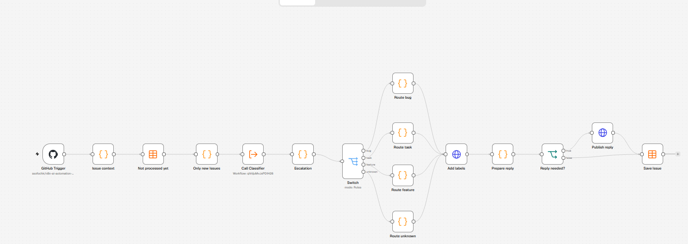

Классификация обращений выполняется с помощью языковой модели GPT-5.4-mini. Модель анализирует заголовок и описание Issue, определяет его тип и степень уверенности в результате.

Для получения структурированного ответа используется Structured Output Parser.

На основе результата классификации Switch node направляет обращение в соответствующую ветку сценария. Через GitHub API автоматически назначается соответствующий лейбл:

| Тип обращения | Лейбл |
|---|---|
| Сообщение об ошибке (bug) | `bug` |
| Задача (task) | `task` |
| Предложение новой функциональности (feature) | `feature-request` |
| Неопределённое обращение (unknown) | `needs-triage` |
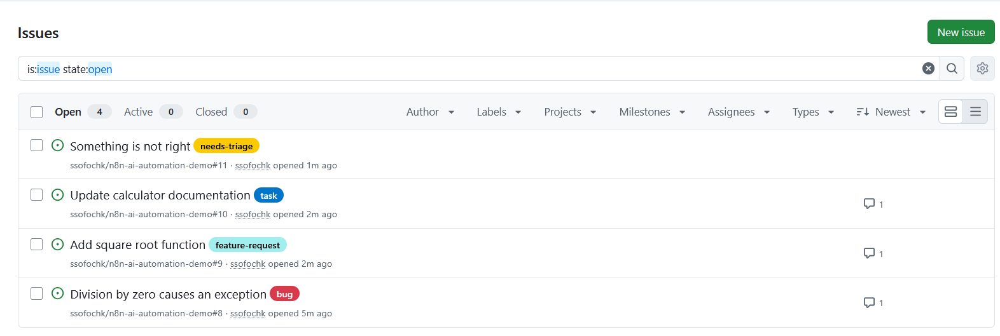

Для распознанных типов обращений предусмотрена автоматическая публикация комментариев.

### Эскалация неопределённых обращений

Если степень уверенности модели ниже 0.8 или тип обращения не определён, Issue направляется в ветку unknown.

Такому обращению присваивается лейбл `needs-triage` для последующей ручной обработки. Автоматический комментарий не публикуется.
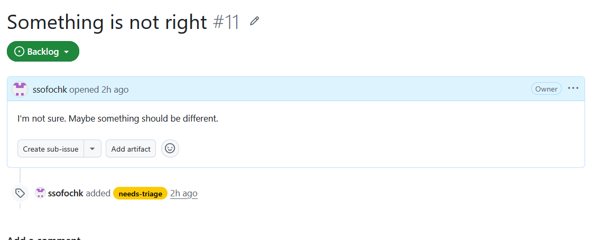
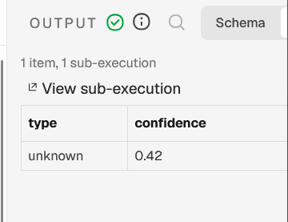
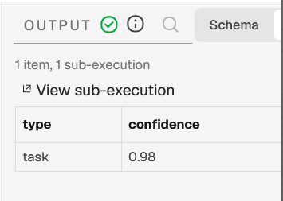

### Выделение классификатора в Sub-workflow

AI-классификатор вынесен в отдельный сценарий Classifier. Для его запуска используется Execute Workflow Trigger.
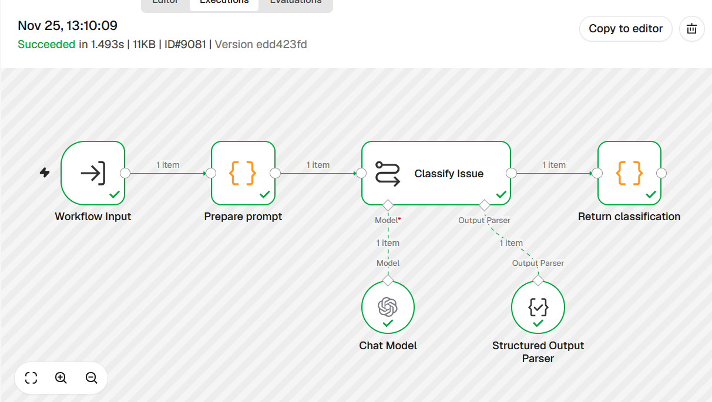
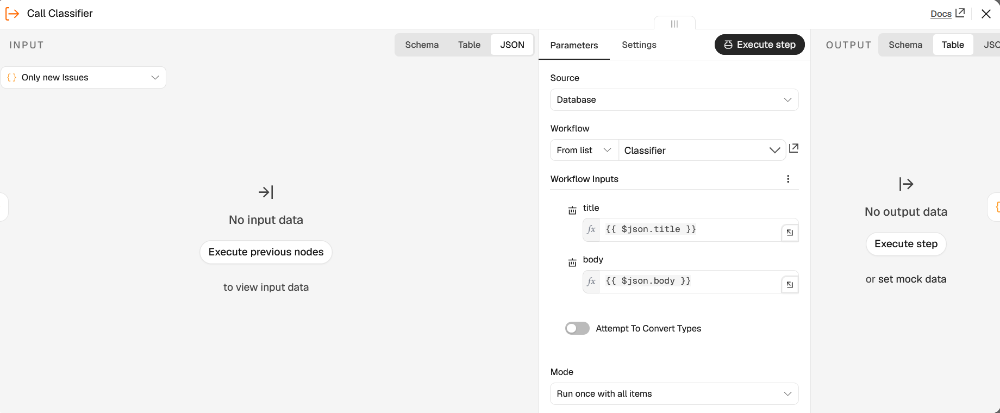

Сценарий принимает два входных параметра:

- `title` — заголовок Issue;
- `body` — описание Issue.

В результате классификации возвращаются два значения:

- `type` — определённый тип обращения;
- `confidence` — степень уверенности модели.

Основной сценарий вызывает классификатор через ноду Call Classifier. Такое разделение позволяет повторно использовать классификатор и изменять его независимо от основной логики обработки обращений.

### Дополнительная функциональность

Для хранения информации об обработанных обращениях используется Data Table `processed_issues`, содержащая идентификатор Issue, автора и дату создания. Таблица используется для предотвращения повторной обработки обращений.
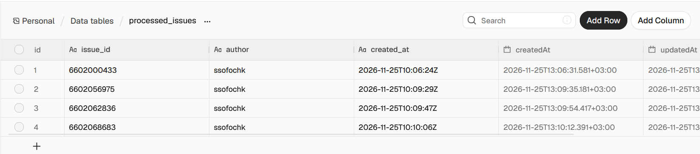

Также предусмотрена отдельная ветка обработки новых участников репозитория на основе параметра `author_association`.
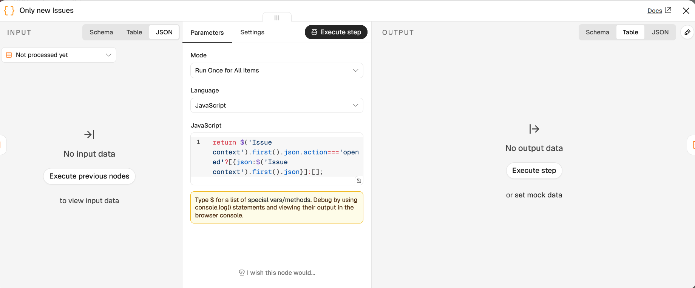

### Проверка работоспособности

Для тестирования сценария в репозитории созданы четыре Issues различных типов.

| Тестовое обращение | Результат классификации | Назначенный лейбл |
|---|---|---|
| Сообщение об ошибке | bug | `bug` |
| Задача | task | `task` |
| Предложение функциональности | feature | `feature-request` |
| Неопределённое обращение | unknown | `needs-triage` |

Все четыре обращения успешно обработаны. Лейблы назначены автоматически, без ручного вмешательства.

Для неопределённого обращения подтверждено отсутствие автоматического комментария. При повторном открытии ранее обработанного Issue новый комментарий не опубликован.

Результаты работы подтверждаются содержимым тестового репозитория, записями Data Table и скриншотами выполненных сценариев во вкладке Executions.
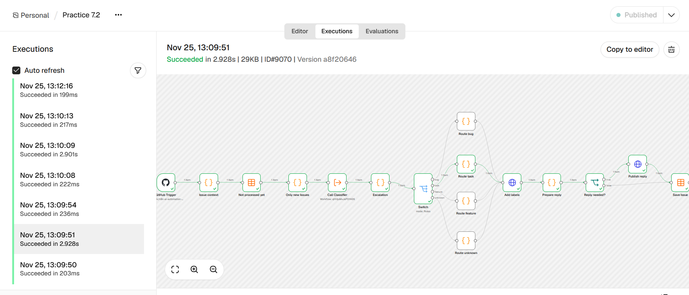
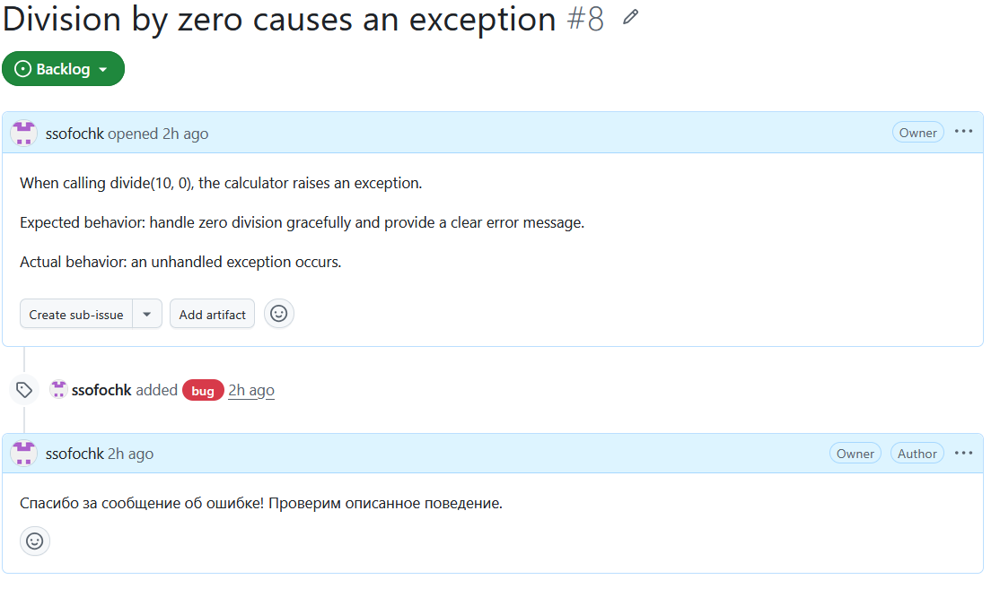
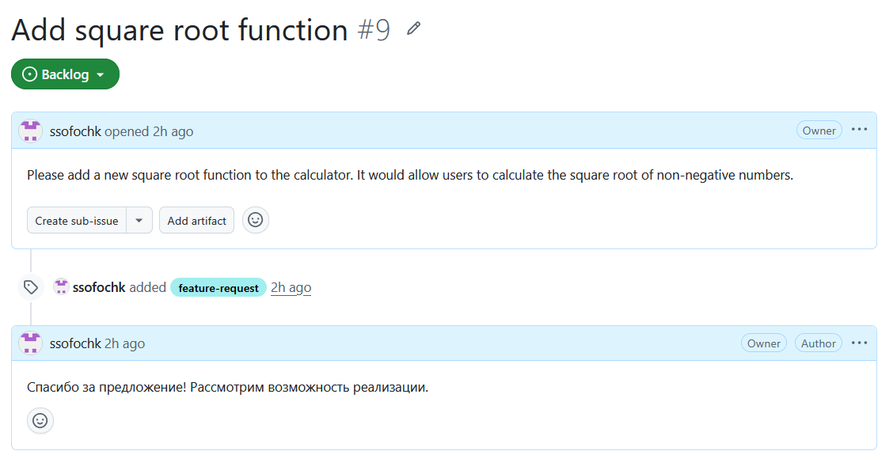
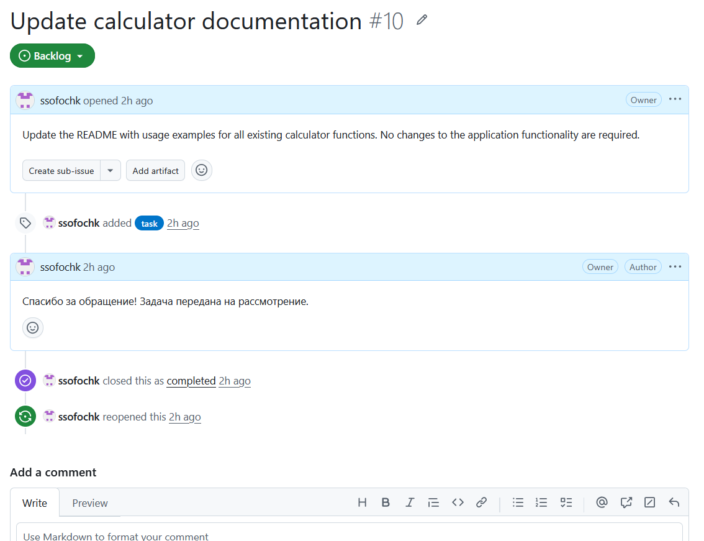
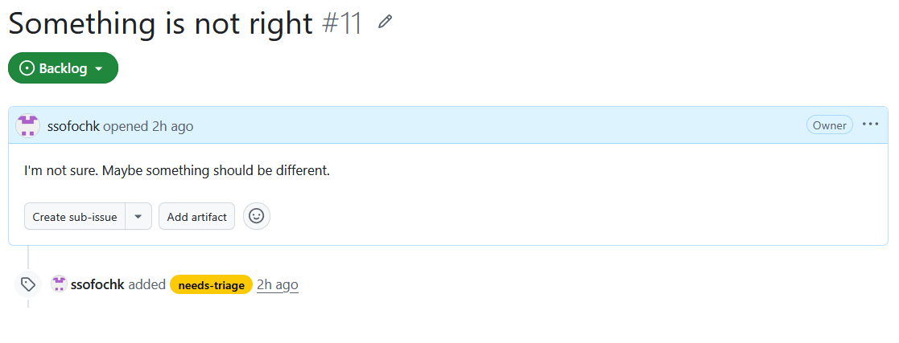

### Еженедельная статистика GitHub

Реализован отдельный сценарий Weekly Statistics, запускаемый каждый понедельник в 09:00 по расписанию `0 9 * * MON`. Для проверки работоспособности использован ручной запуск.
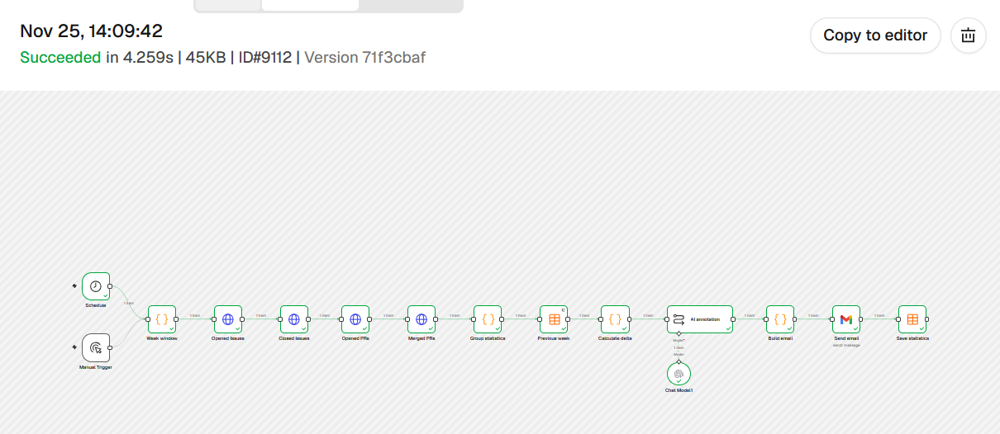
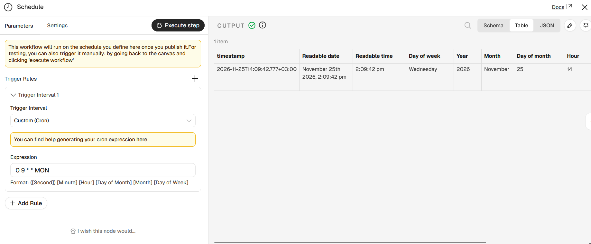

Сценарий выполняет четыре запроса к GitHub API, собирает данные за прошедшую неделю и группирует их по типам Issues и авторам с помощью Code node.
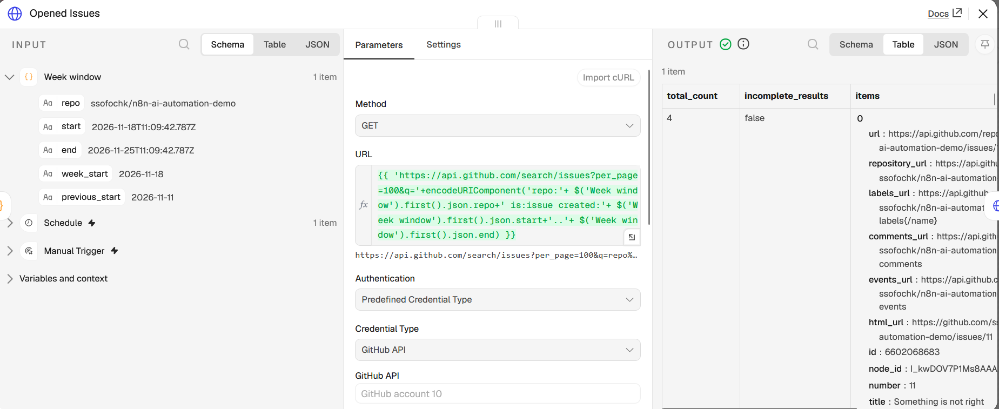
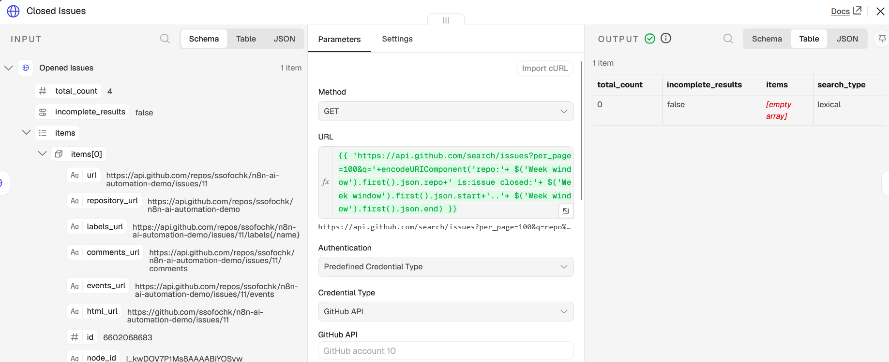
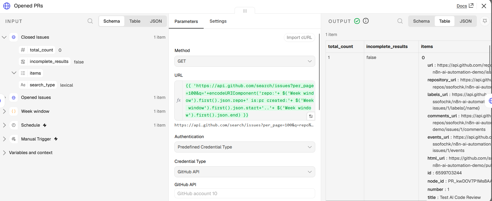
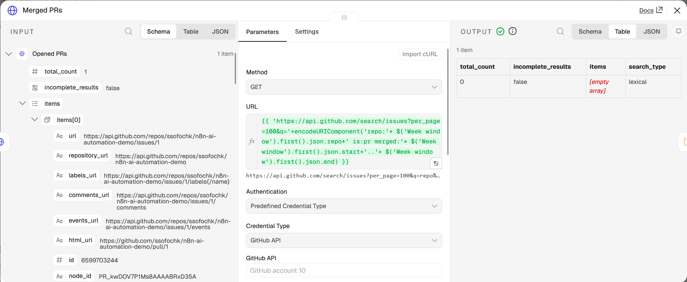

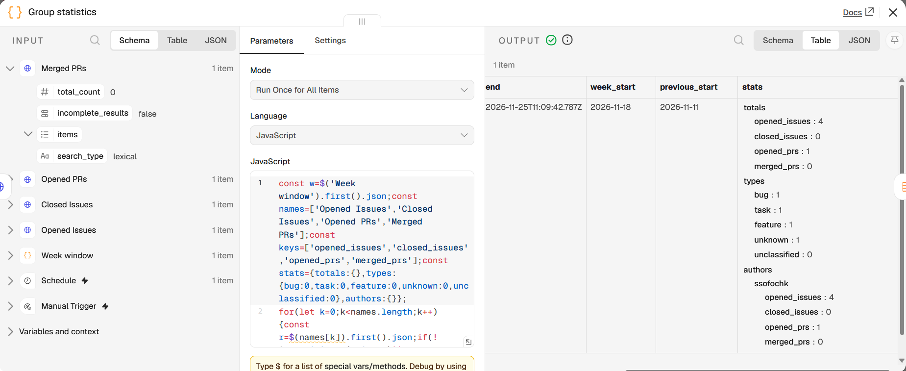

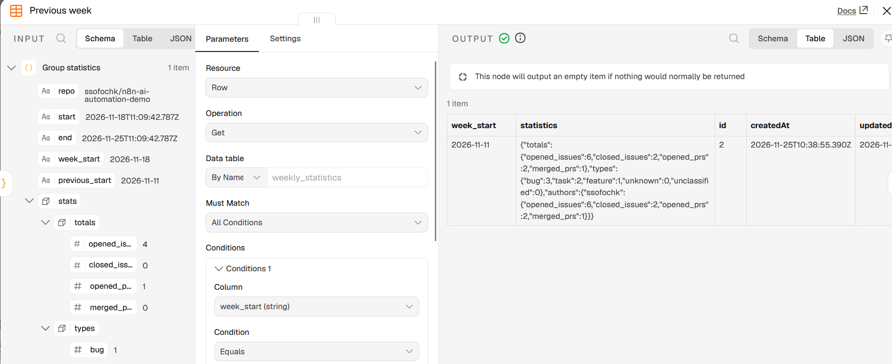

За исследуемый период получены следующие результаты:

- Открыто Issues — 4.
- Закрыто Issues — 0.
- Открыто Pull Requests — 1.
- Смержено Pull Requests — 0.

Среди новых Issues выявлено по одному обращению каждого типа: bug, task, feature и unknown.

Сформированный HTML-отчёт успешно отправлен на электронную почту с помощью Gmail node и авторизации OAuth 2.0.
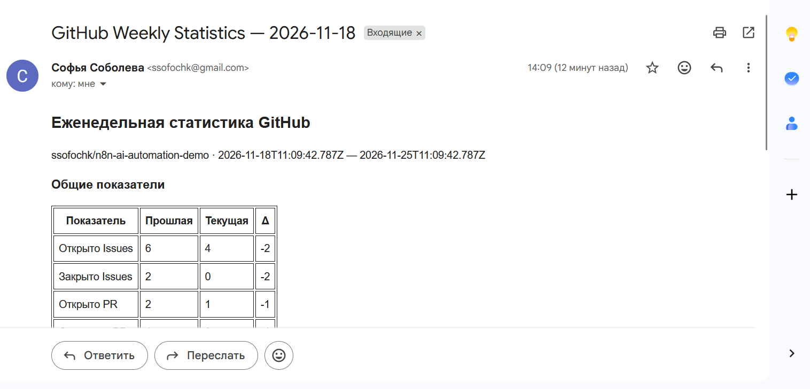
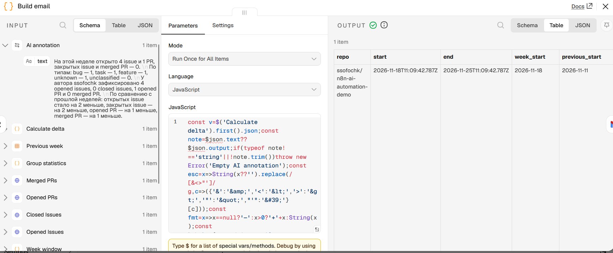
см letter.html

### Задание со звёздочкой

Для хранения статистики используется Data Table `weekly_statistics`. Для демонстрации сравнения добавлена тестовая запись за предыдущую неделю, что допускается условиями задания.

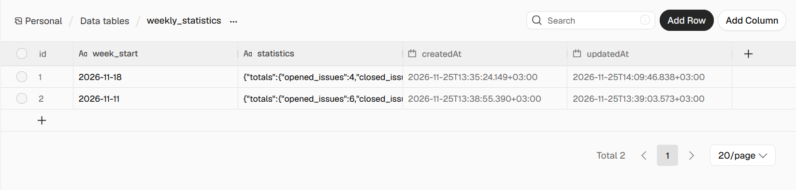

Сценарий автоматически вычисляет изменения относительно предыдущей недели:

- Количество открытых Issues уменьшилось на 2.
- Количество закрытых Issues уменьшилось на 2.
- Количество открытых Pull Requests уменьшилось на 1.
- Количество смерженных Pull Requests уменьшилось на 1.

На основе собранной статистики и рассчитанных изменений языковая модель формирует AI-комментарий недели.

Полученное письмо содержит общие показатели, распределение Issues по типам, статистику по авторам, значения Δ и AI-комментарий. Таким образом, подтверждена работоспособность сценария сбора, анализа, хранения и отправки еженедельной статистики.