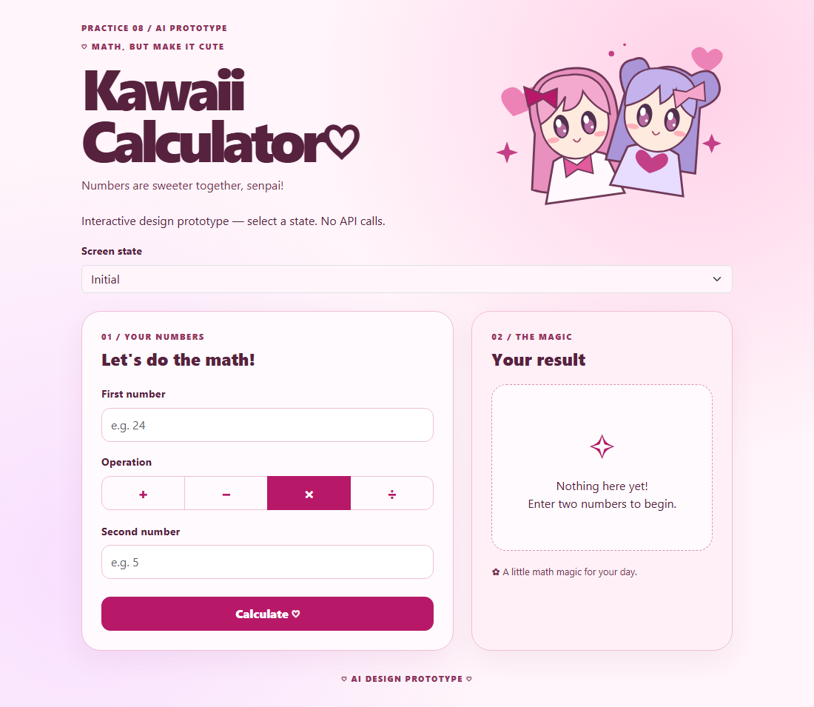
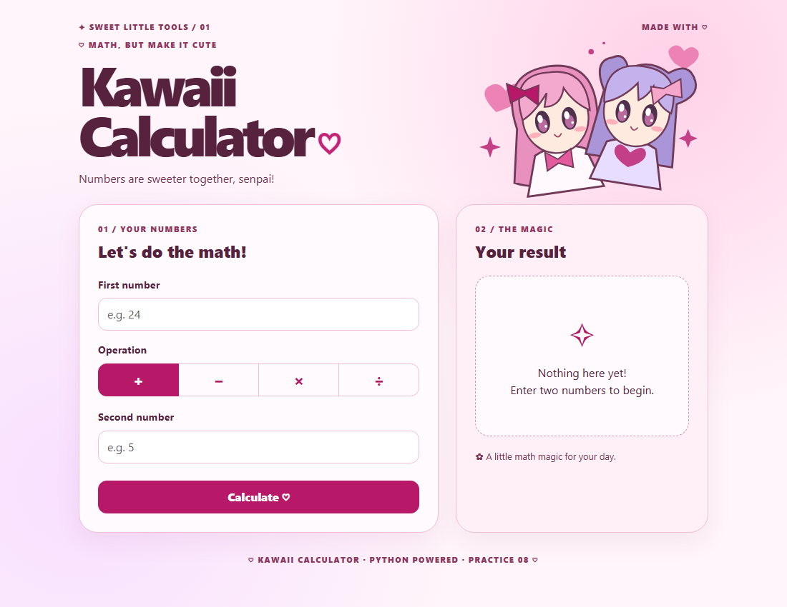
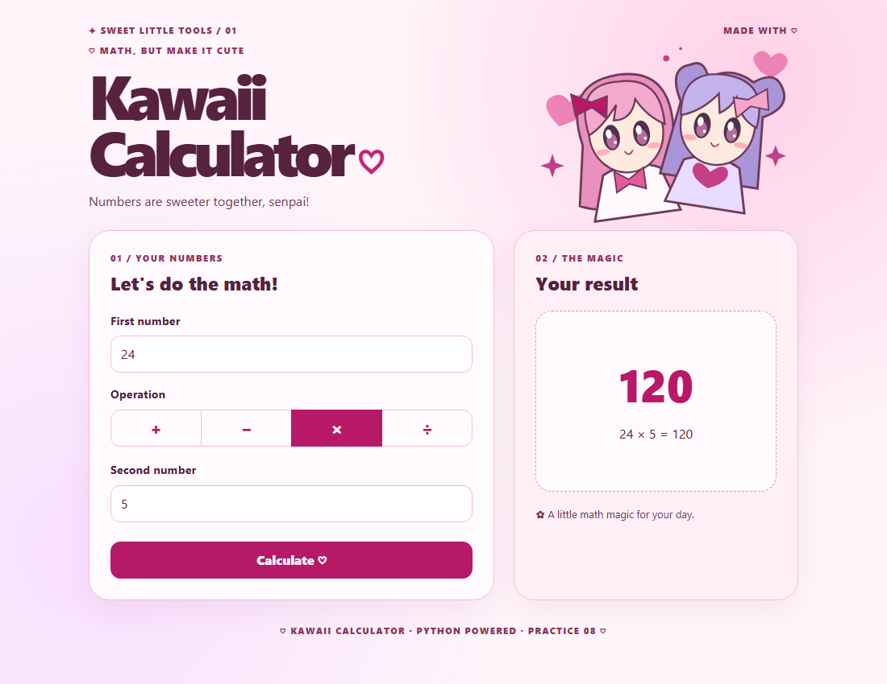
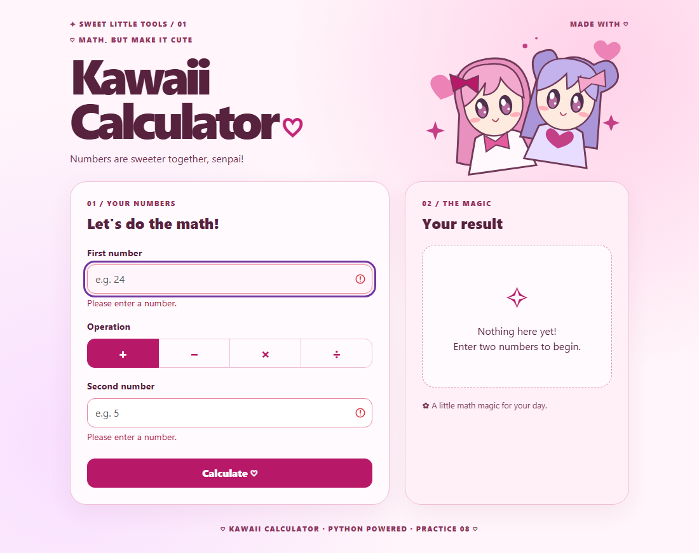
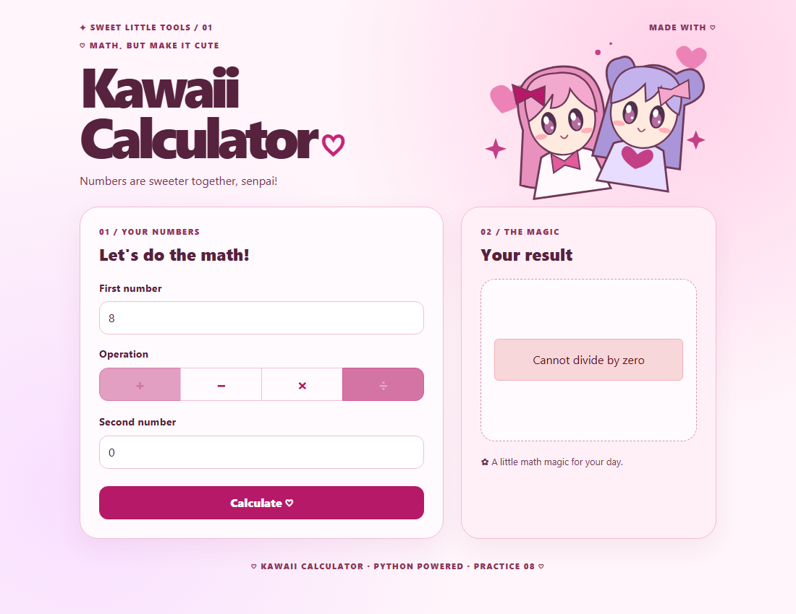
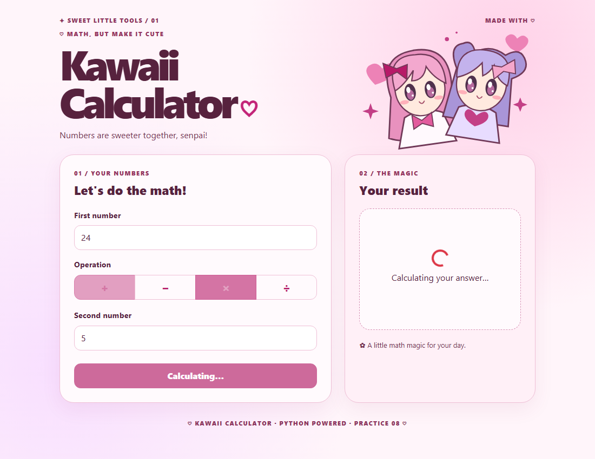
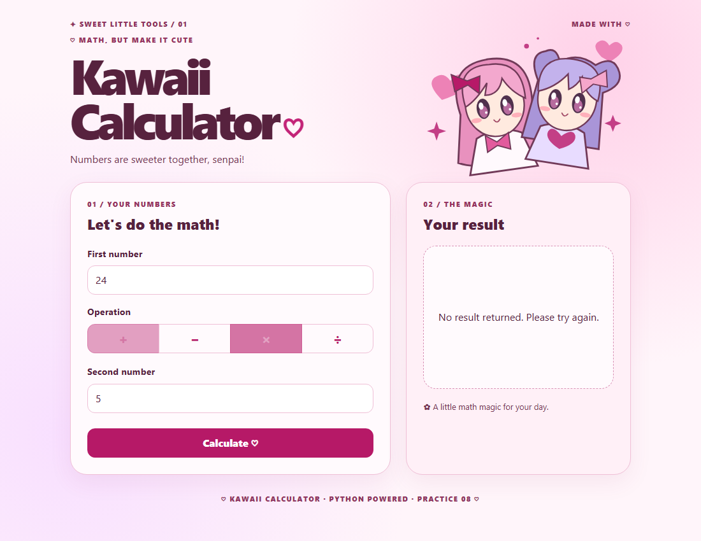
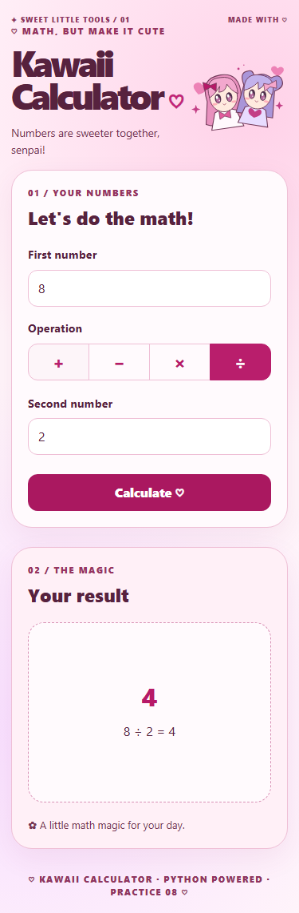
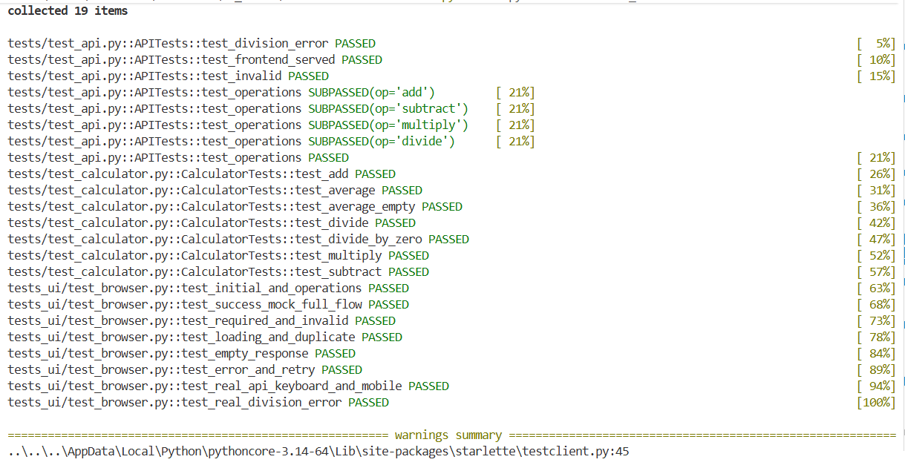
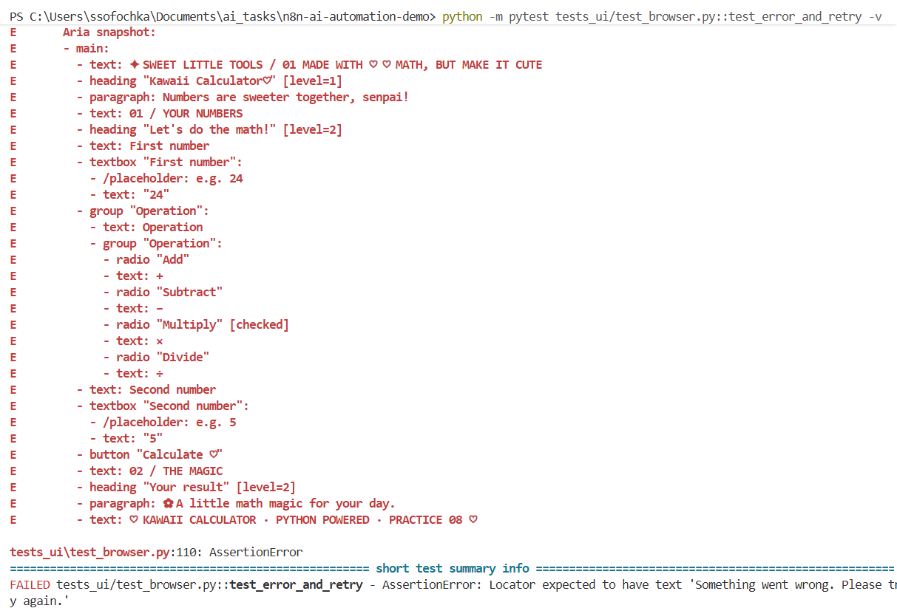

# Практика 8. Добавляем фронтенд к своему проекту с помощью AI

## Цель работы

Разработать пользовательский веб-интерфейс для существующего Python-калькулятора с помощью AI, подключить реальную логику проекта и проверить пользовательские сценарии автоматическими тестами.

**Проект:** Kawaii Calculator — калькулятор в розовом kawaii/anime-стиле.

- [Исходный код, ветка practice-8](https://github.com/ssofochk/n8n-ai-automation-demo/tree/practice-8)
- [README проекта и инструкции запуска](https://github.com/ssofochk/n8n-ai-automation-demo/blob/practice-8/README.md)
- [HTML-прототип](https://github.com/ssofochk/n8n-ai-automation-demo/blob/practice-8/docs/prototype.html) — скачать и открыть в браузере, состояния переключаются в списке.
- [Клиентские тесты](https://github.com/ssofochk/n8n-ai-automation-demo/blob/practice-8/tests_ui/test_browser.py)

## 1. Макет и пользовательский сценарий

Пользователь, которому нужны простые арифметические вычисления, вводит два числа, выбирает одну из четырёх операций и нажимает Calculate. После обращения к API результат отображается в отдельной карточке. При ошибке пользователь может исправить данные и повторить попытку.

С помощью ChatGPT создан HTML-прототип с розово-сиреневой палитрой, двумя chibi-маскотками, полями ввода, выбором операции и карточкой результата. В прототипе предусмотрены состояния исходного экрана, ввода, загрузки, результата, пустого ответа и ошибки. Итоговый интерфейс сохраняет эту структуру.



## 2. Реализация интерфейса

Использованы HTML, CSS, JavaScript, Bootstrap 5.3.6 и FastAPI. Исходная логика `src/calculator.py` сохранена. Фронтенд обращается к `POST /api/calculate`, который вызывает существующие Python-функции. Вычисления не дублируются в JavaScript.

Компоненты Bootstrap: `card`, `form-control`, `btn`, `btn-group`, `alert`, `spinner-border`. Общие цвета, типографика и размеры определены в `frontend/style.css`. Библиотека CSS хранится локально, внешние CDN не требуются.

### Запуск проекта

Из корня тестового репозитория:

```powershell
python -m pip install -r requirements-dev.txt
python -m playwright install chromium
python -m uvicorn src.api:app --reload
```

Приложение доступно по адресу http://127.0.0.1:8000/. Секреты и дополнительные настройки не нужны.

### Исходный экран



### Успешное вычисление через реальный API



### Валидация обязательных полей



### Ошибка вычисления через реальный API



### Загрузка и защита от повторной отправки

Перед вызовом fetch устанавливается флаг `pending`, кнопка блокируется. Повторное событие submit игнорируется до завершения запроса. В блоке finally кнопка снова становится доступной. На скриншоте задержка ответа моделируется с помощью Playwright.



### Пустой ответ

При HTTP 204 или отсутствующем результате интерфейс сообщает об отсутствии данных и позволяет повторить запрос. На скриншоте используется тестовый ответ HTTP 204.



### Доступность и адаптивность

Поля имеют подписи, видимый фокус, сообщения об ошибках; операцию можно выбрать клавиатурой, а форму отправить Enter. Для результата предусмотрен aria-live. На ширине 375 px сценарий проверен автоматическим тестом без горизонтального переполнения.



## 3. Тестирование клиентской части с AI

Использованы pytest и Playwright. Ответы API подменяются через `page.route`, при этом два теста проверяют настоящий API.

| Тест | Проверяемое поведение |
|---|---|
| `test_initial_and_operations` | Исходный экран и выбор операций |
| `test_success_mock_full_flow` | Ввод, отправка, видимый результат и данные запроса |
| `test_required_and_invalid` | Пустые поля, некорректный ввод, отсутствие запроса |
| `test_loading_and_duplicate` | Загрузка, блокировка кнопки, повторный submit и единственный запрос |
| `test_empty_response` | Пустой ответ HTTP 204 |
| `test_error_and_retry` | Ошибка HTTP 500 и успешная повторная попытка |
| `test_real_api_keyboard_and_mobile` | Реальный API, клавиатура, фокус и мобильная ширина |
| `test_real_division_error` | Деление на ноль и исправление данных |

Команда запуска:

```powershell
python -m pytest tests tests_ui -v
```

Фактический результат локального запуска на Windows, Python 3.14.0:

```text
19 passed, 1 warning, 4 subtests passed in 8.00s
```

Успешно пройдены 7 тестов исходной логики, 4 теста API и 8 браузерных тестов. Предупреждение о deprecated alias не привело к падению тестов.



### Проверка качества тестов

Для проверки качества тестов было временно отключено отображение сообщений об ошибках в файле `frontend/app.js`.

После изменения тест `test_error_and_retry` завершился с ошибкой. Это подтверждает, что тест проверяет видимое поведение интерфейса.



После восстановления исходного кода все 19 автоматических тестов снова успешно прошли.

## 4. Использование AI

Инструмент: ChatGPT.

Примеры формулировок для воспроизведения работы (не дословный журнал запросов):

- Макет: «Создай розовый калькулятор с состояниями ввода, загрузки, результата и ошибки».
- Интерфейс: «Используй готовые компоненты Bootstrap, подключи существующие функции Python через FastAPI, обеспечь доступность и защиту от повторной отправки».
- Тесты: «Напиши Playwright-тесты видимого поведения с подменой успешного, пустого, задержанного и ошибочного ответа API. Проверь повторную отправку и реальный пользовательский сценарий».

В ходе работы первоначально предложенный React/MUI заменён на Bootstrap и обычный JavaScript из-за недоступности npm в среде генерации. Логика существующего калькулятора сохранена. После получения проекта выполнена локальная проверка работы приложения. При первом запуске тестов pytest собирал файлы других практик из общей директории; после перехода в корень проекта все 19 тестов успешно прошли. Проект опубликован в существующем тестовом репозитории.

## Вывод

Для существующего Python-калькулятора разработан веб-интерфейс с реальным API, единой визуальной темой, обработкой состояний и автоматизированными проверками пользовательского поведения. Локальный запуск приложения и успешное прохождение всех тестов подтверждены.
